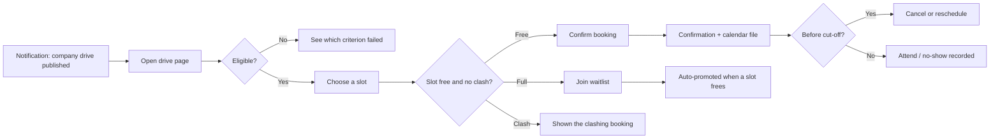
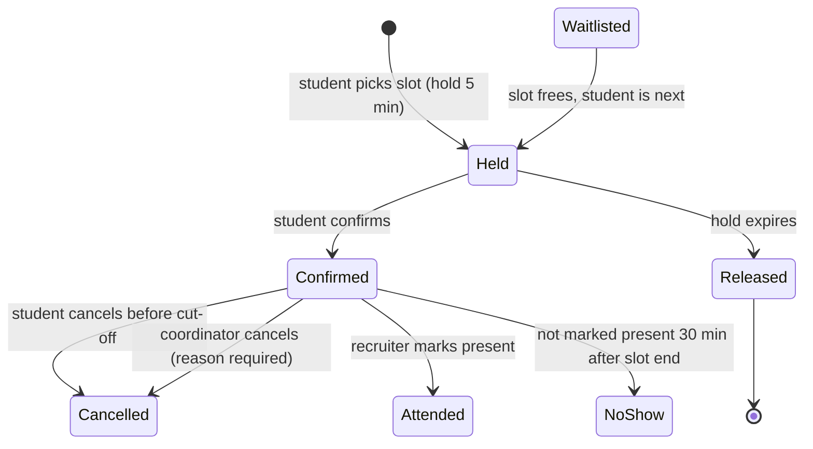

# SlotSure — Requirements

Fictional scenario. **Northfield Business School** (invented) runs on-campus placement interviews. Today, students book interview slots by replying to an email thread and the placement office reconciles a spreadsheet by hand. Double bookings, empty slots and last-minute no-shows are common.

SlotSure is a proposed web booking flow for interview slots. This document covers personas, the journey, requirements with acceptance criteria, business rules and edge cases. It is a **requirements case study**: nothing here is implemented.

---

## 1. Personas

| Persona | Goal | Frustration today | What success looks like |
|---|---|---|---|
| **Riya — final-year student** | Book interviews with the companies she wants, without clashes | Slots vanish in the email thread; she found out about a clash on the day | Books in under 2 minutes, sees her schedule in one place |
| **Arjun — placement coordinator** | Fill every slot and keep the day running on time | Rebuilds the schedule from replies; chases no-shows by phone | A live list of who is booked where, with gaps visible early |
| **Meera — campus recruiter (external)** | Meet eligible candidates only, on time | Receives students who don't meet the criteria; idle slots | A shortlist that matches the criteria, with few empty slots |
| **Placement head (approver)** | Fair process, defensible decisions | No record of why exceptions were made | Every override has a reason and a name attached |

## 2. Journey (student)

## 3. Booking states

## 4. User stories and acceptance criteria

IDs are referenced by the test scenarios.

### Student

**US-01 Book a slot.** As a student, I want to book an interview slot so that I am guaranteed a time with the recruiter.
- **AC-01.1** Given I am eligible and the slot has capacity, when I confirm, then the booking is *Confirmed*, the slot's remaining capacity drops by one, and I see a confirmation with date, time, venue and a calendar (.ics) download.
- **AC-01.2** Given two students confirm the last place at the same moment, then exactly one booking is confirmed and the other student is offered the waitlist.
- **AC-01.3** Given I select a slot, then it is held for me for 5 minutes; if I do not confirm, the hold is released.

**US-02 See why I can't book.** As a student, I want to see which eligibility rule I fail so that I know whether to contact the placement office.
- **AC-02.1** Given I do not meet a criterion (BR-01, BR-02), then the slot list is hidden and the failed criterion is named, e.g. "CGPA 6.8 is below this drive's minimum of 7.0".
- **AC-02.2** The message never shows another student's data.

**US-03 Avoid clashes.** As a student, I want the system to stop me double-booking myself.
- **AC-03.1** Given I hold a confirmed booking from 10:00–10:30, when I try to book any slot overlapping that time (including the 15-minute buffer, BR-05), then the booking is refused and the clashing booking is shown.

**US-04 Cancel or reschedule.** As a student, I want to cancel or move my booking so that the slot goes to someone else.
- **AC-04.1** Given it is more than 12 hours before the slot, when I cancel, then the booking is *Cancelled* and the first waitlisted student is offered the slot (BR-07).
- **AC-04.2** Given it is 12 hours or less before the slot, then self-service cancel is disabled and I am told to contact the coordinator.
- **AC-04.3** Rescheduling is a cancel plus a new booking performed atomically: if the new slot cannot be booked, the original booking is kept.

**US-05 Waitlist.** As a student, I want to join a waitlist for a full slot.
- **AC-05.1** Given a slot is full, when I join the waitlist, then I see my position.
- **AC-05.2** Given a place frees up, then the first student on the waitlist gets a 5-minute hold and a notification; if they do not confirm, the offer passes to the next student.
- **AC-05.3** Waitlist offers stop 12 hours before the slot.

### Coordinator

**US-06 Publish a drive.** As a coordinator, I want to publish a company drive with slots, capacity and eligibility criteria.
- **AC-06.1** A drive cannot be published without: company name, at least one slot, capacity per slot ≥ 1, booking-window open time, and eligibility criteria (may be "none").
- **AC-06.2** Eligible students are notified when the booking window opens, not when the drive is created.

**US-07 Override with a reason.** As a coordinator, I want to book, cancel or move a student's booking on their behalf, including after the cut-off.
- **AC-07.1** Every override requires a free-text reason of at least 10 characters and is recorded in the audit log with who, when, what changed and why.
- **AC-07.2** An override cannot exceed slot capacity unless the coordinator explicitly increases the capacity first.

**US-08 Live schedule.** As a coordinator, I want a live view of each drive.
- **AC-08.1** The view shows, per slot: capacity, confirmed, waitlisted, attended, no-show.
- **AC-08.2** The view can be exported as CSV.

### Recruiter

**US-09 Mark attendance.** As a recruiter, I want to mark each candidate present so the placement office knows who attended.
- **AC-09.1** A recruiter sees only their own company's slots and the candidates booked into them.
- **AC-09.2** Bookings not marked present 30 minutes after slot end become *No-show* automatically; the coordinator can correct this within 24 hours with a reason.

## 5. Business rules

| ID | Rule | Rationale |
|---|---|---|
| BR-01 | Eligibility: CGPA ≥ the drive's minimum (set per drive) | Recruiters' criteria |
| BR-02 | Eligibility: no active backlogs, unless the drive allows them | Recruiters' criteria |
| BR-03 | A student who has **accepted** an offer cannot book further drives; their open bookings are cancelled and waitlists notified | School's one-offer policy |
| BR-04 | A student may hold at most **3** confirmed future bookings at a time | Stops slot hoarding |
| BR-05 | No two of a student's bookings may overlap, including a **15-minute** buffer between slots | Interviews overrun |
| BR-06 | Booking opens at the published time for all eligible students at once (no early access) | Fairness |
| BR-07 | Self-service cancel or reschedule allowed until **12 hours** before the slot | Gives the waitlist time to fill |
| BR-08 | **2 no-shows** in a placement season suspend self-service booking until the coordinator lifts it | Protects recruiter time |
| BR-09 | Slot holds last **5 minutes** | Prevents abandoned holds blocking others |
| BR-10 | All times are stored in one time zone (IST) and shown with the venue | Avoids clock confusion for external recruiters |
| BR-11 | Every change by staff is audited (who, when, before, after, reason) | Accountability |

All numbers above are proposals for this fictional school, chosen to make the trade-offs explicit; each would be confirmed with the placement head.

## 6. Edge cases

| # | Situation | Expected behaviour |
|---|---|---|
| E-01 | Two students confirm the last place simultaneously | One confirmed, one offered the waitlist (AC-01.2) |
| E-02 | Student's CGPA is updated after booking and falls below the minimum | Booking stays; coordinator is alerted to review (no silent cancellation) |
| E-03 | Recruiter reduces capacity below the number already confirmed | Refused; coordinator must move or cancel bookings first |
| E-04 | Drive is cancelled by the company | All bookings cancelled, students notified, no no-show recorded |
| E-05 | Student accepts an offer while holding a waitlist position | Removed from all waitlists (BR-03) |
| E-06 | Waitlist offer sent 12 h 2 min before the slot; student confirms at 11 h 58 min | Confirmation accepted: the offer was valid when made |
| E-07 | Slot time changed by the coordinator after bookings | Booked students notified; any new clash (BR-05) is flagged to the coordinator, not auto-resolved |
| E-08 | Student is on the waitlist for a slot that clashes with a booking they make later | Waitlist position kept; if offered, the clash rule applies at that time |
| E-09 | Daylight-saving time for an overseas recruiter joining remotely | Times shown in IST with the recruiter's local time alongside |
| E-10 | Booking window opens and traffic spikes | Holds and capacity checks must remain correct under load (see T-20) |

## 7. Non-functional requirements

- **Accessibility:** WCAG 2.2 AA; all actions usable by keyboard; status changes announced to screen readers.
- **Privacy:** recruiters see candidates' names and CVs only for their own slots; CGPA is shown only to the student and staff.
- **Auditability:** the audit log is append-only and retained for the placement season plus one year.
- **Performance:** booking confirmation under 2 seconds at the 95th percentile with 500 concurrent students.
