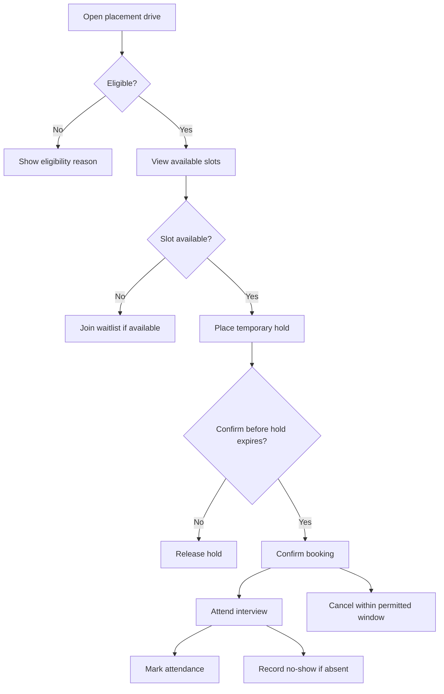
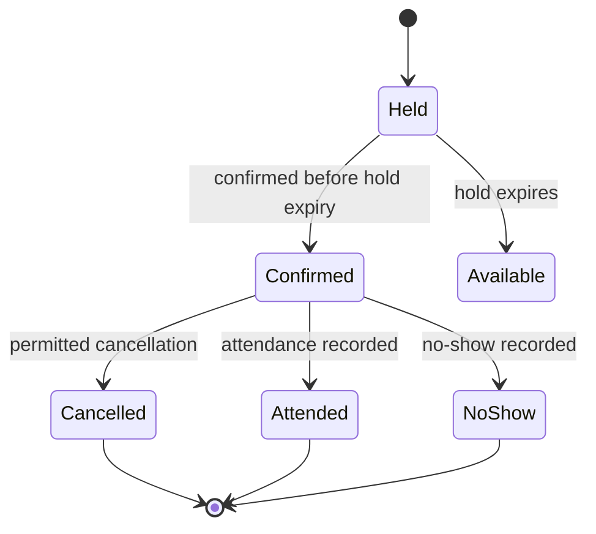

# SlotSure — Workflow and booking states

This page visualises the proposed workflow described in the requirements. It is a specification aid, not a diagram of a built application.

## Student booking journey

## Booking lifecycle (conceptual)

## Reading this diagram

- Eligibility is checked before the student can hold a slot.
- A hold is temporary and must be confirmed before expiry.
- A waitlist is an alternative when capacity is full; the detailed offer and promotion rules remain in the requirements document.
- Cancellation, attendance and no-show behaviour are governed by the numbered business rules and acceptance criteria.

For exact behaviour and boundary cases, use [requirements.md](requirements.md) and [test-scenarios.md](test-scenarios.md). These diagrams summarise the proposal and do not replace those specifications.
